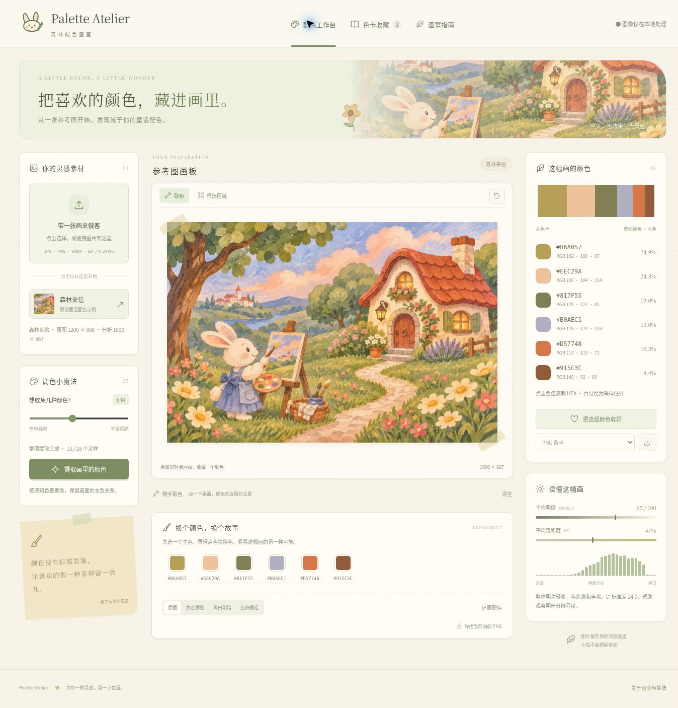

# Palette Atelier · 森林配色画室

把参考图里的颜色收集成自己的调色盘。童话绘本风的浏览器绘画辅助工具，支持区域主色提取、手动取色、明暗分析与换色实验，用户图片完全在浏览器本地处理。

**这是参考图分析与配色工具，不是绘画软件或 AI 自动上色服务。**



## 能做什么

- JPG / PNG / WebP / GIF 首帧导入与拖拽；内置童话森林参考图。
- 整图或矩形区域提取 3–10 个主色，展示 HEX、RGB 和估计占比；实际颜色不足时不制造额外颜色。
- 点击当前画面取色；一键复制 HEX。
- D65 CIELAB L* 明度直方图、平均明度、明度标准差及平均 HSL 饱和度。
- 色块和 HEX 精确换色、原图 / 换色 / 黑白明暗 / 色块概括四种视图。
- 导出工作图 PNG、色卡 PNG / JSON / GIMP-Krita GPL。
- 本地收藏、名称编辑、JSON 导入备份，最多 50 组，不保存原图。
- Web Worker 计算，Worker 不可用时回退主线程；过期计算结果不会覆盖新图。

## 使用

无需安装 Node 依赖。从仓库下载 ZIP 解压后，在项目根目录运行：

```sh
python -m http.server 8000
```

在浏览器打开 `http://localhost:8000/`。根目录 `index.html` 是包含图像、CSS、算法和 Blob Worker 的单文件版；源码开发入口在 `dist/`。单文件支持离线使用，但本次未验证各浏览器的 `file://` 行为，建议通过 HTTP 打开。

操作示例：打开内置「森林来信」→选择 6 色→点击提取→点击主色 HEX 复制→在画面框选屋顶后重新提取→修改换色区的 HEX 查看另一种配色→保存或导出。

右侧色卡、统计与收藏对应**提取时的原始参考图/区域**；下方换色实验与画面 PNG 对应**当前预览**。换色后不会悄悄覆盖原始色卡。

## GitHub Pages

本仓库已包含根目录 `index.html` 和 `.nojekyll`。在 Settings → Pages 选择 Deploy from a branch、`main`、`/(root)` 并保存即可。**启用前不视为在线站点，部署成功后再把 GitHub 返回的地址加入 README。**

## 算法与边界

工作图最长边 1000 px；原图限 20 MB、6400 万像素。分层空间采样约 ≤16,384 点（极窄图可能略多），alpha 加权，低于 2% 不透明度忽略。5 bit RGB 分桶后，转 D65 CIELAB，按感知色差 ΔE76 做确定性加权 K-means，最多 24 轮；以簇内 RGB 加权均值作为色卡。相同工作像素与参数下结果可复现。缩放与抽样会影响很小的颜色区域。

换色先找最近色簇，再平移 Lab 色度，并添加 35% 的目标与原簇明度差；保留局部明暗变化。它不是语义蒙版，相近颜色可能一起变化。超出 sRGB 的颜色会裁切，不能保证色差严格不变。

浏览器把图像解码到 sRGB 画布。这里没有 ICC 软打样、印刷 CMYK、光谱颜色或 CIEDE2000；不适合作为色彩校准测量工具。GIF 只使用浏览器解码的静态帧。

## 验证

```sh
npm run check
npm test
python3 scripts/build-portable.py
```

16 项 Node 测试覆盖 Lab 参考值与往返、已知 75/25 色块、区域隔离、透明度、单色图、确定性、占比归一化、采样预算、换色 alpha 与灰度/色块输出。详见 [验证记录](docs/VALIDATION.md)。无需安装第三方运行依赖。

## 文件结构

- `dist/index.html`、`style.css`、`app.js`：界面、交互、导出与本地收藏
- `dist/engine.js`：可在浏览器和 Node 复用的纯计算引擎
- `dist/worker.js`：工作线程入口
- `dist/assets/`：插画和兔子图标
- `tests/`：数值和图像边界测试
- `scripts/build-portable.py`：可复现的单文件构建
- `index.html`：便携版与 Pages 首页

## 素材与隐私

内置「森林来信」由 AI 为本项目生成；兔子、画笔、叶片等 SVG 图标由项目代码绘制。素材制作说明见 [ASSETS.md](docs/ASSETS.md)。没有上传接口、账号、第三方分析或追踪脚本。联网用于加载网站和内置素材；收藏只写入当前浏览器的 localStorage，清理站点数据会删除它，请导出备份。

## 简历描述（按实际掌握程度使用）

开发浏览器端参考图配色工作台，实现透明度加权的 CIELAB 主色聚类、区域分析、明度分布与换色预览；以 Web Worker 处理计算任务，提供本地收藏及 PNG/JSON/GPL 导出，并以已知色块和边界样本验证颜色计算。
